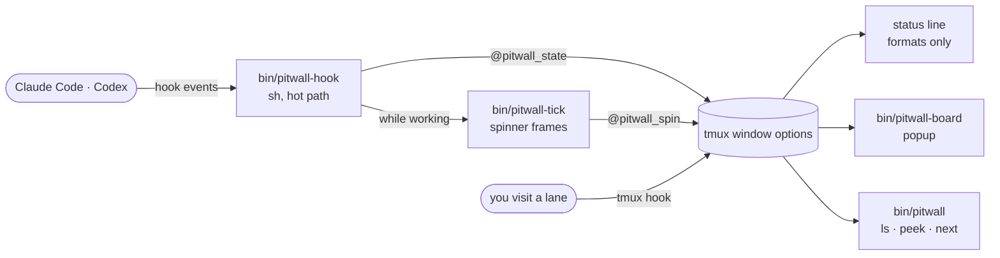

# pitwall

<p align="center">
  
</p>

<p align="center">
  <a href="https://github.com/mateonunez/pitwall/actions/workflows/main.yml"></a>
  <a href="LICENSE"></a>
  
</p>

Hey there! I'm **pitwall**. You run a handful of coding agents in tmux, one per window. I keep an eye on all of them and put what each one is doing right in your status line: working, waiting for you, or finished while you were looking somewhere else. One key shows every lane; another takes you to the one that needs you.

Your agents tell me their state through a hook. I never poll, never read a transcript and never touch the network.

> **Status:** pre-1.0, used every day on one machine with Claude Code and Codex. Expect behaviour to change between commits.

## Quick start

You need tmux 3.2 or newer and a POSIX shell. The installer uses python3 to edit JSON safely.

```sh
git clone https://github.com/mateonunez/pitwall.git
ln -s "$PWD/pitwall" ~/.tmux/plugins/pitwall
ln -s "$PWD/pitwall/bin/pitwall" ~/.local/bin/pitwall   # or anywhere on your PATH
```

Add me to your tmux config next to your other plugins, then reload it:

```tmux
set -g @plugin 'mateonunez/pitwall'
```

Teach your agents to report:

```sh
pitwall install           # shows the hook lines it would add, changes nothing
pitwall install --write   # adds them, with a backup beside each file
pitwall doctor            # says what is missing, and exits 1 when something is
```

Restart your agents so they pick up the hooks; Codex asks you to trust each new one. Only want to look? `pitwall demo` starts a throwaway tmux server with a few fake lanes, and `pitwall demo stop` removes it.

## What you get

- **A status line that says who needs you.** `◆` amber: the agent is asking you something. `✓` green: it finished while you were elsewhere, and stays until you visit. A spinner while it works, `○` when it rests, `✗` when it has gone. I slip the glyph in front of the window name inside the format your theme already has, so your theme stays yours.
- **Instant, and quiet when nothing moves.** A change redraws every status line at once and shows a short toast to anyone not already looking at that lane. The spinner turns only while something works, then the ticker exits.
- **The board.** `prefix A` groups lanes into Needs you, Working and Idle, with a live preview of the selected pane. Keys are Colemak and vim: `n` `e` to move, `i` or `⏎` to jump in, `1`–`9` to pick, `d` `D` for first and last, `h` `q` `esc` to close. Arrows work too.
- **The jump.** `prefix a` takes you to the next lane that is asking or done. Press it again to cycle.
- **Several agents in one window.** Each pane is its own lane (`ait.1`, `ait.2`); the window shows the most urgent of them.
- **Names that mean something.** A window running Claude Code shows up as `2.1.323`; I name it after the agent's directory instead.
- **Your agents survive a dead tmux.** Every agent session leaves a small record as it works. When the tmux server dies, the status line says `↺ 4` next time, and `prefix R` (or `pitwall restore` from any terminal) rebuilds the sessions, windows and panes and resumes each agent where it was. An agent you closed on purpose stays closed.
- **Context on every lane.** The board's preview names the model, how full the context is and how many tokens the session has used, read from the agent's own transcript; `pitwall stats` prints it for all lanes. Your Claude and Codex usage limits sit in the status line with the time left to each reset (`claude 5h 8% ↻4h · wk 34% ↻5d`), from [CodexBar](https://github.com/steipete/CodexBar), refreshed when a turn ends. A number turns amber at 80%, and so does a week on course to run out before its reset.
- **Lanes as worktrees.** `pitwall new fix-login` makes a worktree with [gwm](https://github.com/kbrdn1/gwm), opens a window there and starts your agent. `pitwall done @3` shows the diff in [lumen](https://github.com/jnsahaj/lumen), and removes the worktree only if you say so.
- **Nothing waits unnoticed.** A lane that has been asking for ten minutes turns its `◆` red and shows a toast; there is no polling, just one delayed check scheduled when it starts asking.
- **Needs you, beyond the terminal.** Connect an [OpenTimeline](https://github.com/mateonunez/opentimeline) system seat with `pitwall ot connect <token-file>` and a lane that starts asking shows up in its Needs you, turns urgent after ten minutes, and clears when the lane moves on. Signals carry the state, the agent and its metrics, never prompts or task titles. With `pitwall ot bell <token-file>`, Needs you's count sits in the status line (`⚑ 3`).
- **Made for agents as well.** `pitwall ls` prints one line per lane with a ref (`@1 lab/opentimeline asking 3m codex Cut the 0.2.0 release`), `--json` for scripts, and `pitwall peek @1` shows that lane's last lines. An orchestrator reads your whole fleet with one call.

## Keys and commands

| Key | Does |
| --- | --- |
| `prefix A` | The board |
| `prefix a` | Next lane that needs you |
| `prefix R` | Restore the lanes a dead tmux took with it |

| Command | Does |
| --- | --- |
| `pitwall ls [--json]` | Every lane, the ones that need you first |
| `pitwall peek @N [lines]` | The last lines of a lane |
| `pitwall go @N` | Jump to a lane |
| `pitwall next` | Jump to the next lane that is asking or done |
| `pitwall board` | The board, outside a popup |
| `pitwall stats [@N]` | Model, context and tokens per lane |
| `pitwall quota [--refresh]` | Claude and Codex usage limits |
| `pitwall saved` | The lanes pitwall can bring back, and which are running or closed |
| `pitwall restore [--dry\|--all]` | Reopen them, resuming each agent |
| `pitwall forget <id>` | Drop a saved lane |
| `pitwall ot connect <token> [--url URL]` | Send lane states to OpenTimeline; also `status`, `flush`, `disconnect` |
| `pitwall ot bell <token>` | Needs you's count in the status line; `off` to stop |
| `pitwall new <name> [--agent codex]` | Worktree, window and agent in one go |
| `pitwall done @N` | Review the diff, then remove the worktree if you confirm |
| `pitwall install [--write]` | The hook lines for Claude Code and Codex |
| `pitwall doctor` | What is missing |
| `pitwall demo [stop]` | A throwaway server with fake lanes |

## Options

Set them before the plugin loads, like any tmux option.

| Option | Default | Does |
| --- | --- | --- |
| `@pitwall-key-board` | `A` | Key for the board |
| `@pitwall-key-next` | `a` | Key for the jump |
| `@pitwall-key-restore` | `R` | Key for restore |
| `@pitwall-agent` | `claude` | Agent `pitwall new` starts |
| `@pitwall-resume-claude` · `-codex` | `claude --resume {id}` · `codex resume {id}` | How a saved session resumes |
| `@pitwall-quota` | `on` | Usage limits in the status line |
| `@pitwall-codexbar` | the CLI inside CodexBar.app | Path to `CodexBarCLI` |
| `@pitwall-color-asking` · `-done` · `-gone` | `#f59e0b` · `#00c758` · `#fb2c36` | Glyph colours |
| `@pitwall-rename` | `on` | Name agent windows after their directory |
| `@pitwall-toast` | `on` | Toast when a lane starts asking or finishes |
| `@pitwall-urgent-after` | `600` | Seconds of asking before a lane turns urgent; `0` turns it off |
| `@pitwall-tick-interval` | `0.12` | Seconds per spinner frame |

## How it fits together



The hook runs on every tool call next to whatever else you have hooked, so it stays in `sh` and makes two tmux calls when nothing changed. It writes the restore record (`~/.local/state/pitwall/lanes/<session>`) only when a session starts and once per turn. Rendering is tmux format strings reading window options: no process per redraw. Without hooks I still read a working Codex from the spinner in its pane title. The domain words are in [CONTEXT.md](CONTEXT.md).

## What's next

Metrics over time, a board you can filter by typing, and a skill so agents learn to read the fleet. The reasoning is in [docs/roadmap.md](docs/roadmap.md).

## Develop

`test/run.sh` runs every check on a throwaway tmux server and never touches yours: its config, state and OpenTimeline connection are temporary. [AGENTS.md](AGENTS.md) has the rules for changing me.

Releases follow [Conventional Commits](https://www.conventionalcommits.org): release-please keeps a release PR open on `main` with the next version and the changelog, and merging it tags the release. `pitwall --version` prints what you run.

## License

MIT
