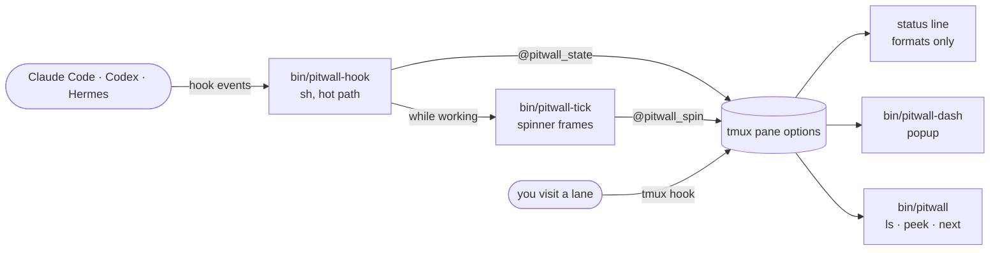

# pitwall

<p align="center">
  
</p>

<p align="center">
  <a href="https://github.com/mateonunez/pitwall/actions/workflows/main.yml"></a>
  <a href="LICENSE"></a>
  
</p>

Hey there! I'm **pitwall**. You run a few coding agents in tmux, and I keep an eye on all of them for you. Your status line tells you which one is working, which one is waiting for you, and which one finished while you were looking somewhere else. One key lists them all; another takes you straight to the one that needs you.

Your agents tell me what they are doing through a hook. I never poll and never read your prompts; I touch the network only through a plugin you add, like OpenTimeline's.

> **Status:** pre-1.0, used every day with Claude Code, Codex and Hermes. Things can still change between releases.

## Quick start

You need tmux 3.2 or newer. The installer uses python3 to edit your agents' settings safely.

**1. Add me to tmux.** Put this line next to your other plugins in your tmux config, then press `prefix` + `I` to let [TPM](https://github.com/tmux-plugins/tpm) fetch me:

```tmux
set -g @plugin 'mateonunez/pitwall'
```

**2. Put the `pitwall` command on your PATH:**

```sh
ln -s ~/.tmux/plugins/pitwall/bin/pitwall ~/.local/bin/pitwall   # or anywhere on your PATH
```

**3. Teach your agents to report:**

```sh
pitwall install           # shows what it would add, changes nothing
pitwall install --write   # adds it, with a backup next to each file it touches
```

**4. Restart your agents.** They read hooks when they start. Codex asks you to trust each new hook, and Hermes asks you to approve each one once: say yes.

**5. Check.** `pitwall doctor` lists anything still missing.

Just want a look first? `pitwall demo` starts a throwaway tmux server with a few fake lanes (attach with `tmux -L pitwall-demo attach`), and `pitwall demo stop` removes it.

<details>
<summary>Without TPM</summary>

```sh
git clone https://github.com/mateonunez/pitwall.git
ln -s "$PWD/pitwall" ~/.tmux/plugins/pitwall
ln -s "$PWD/pitwall/bin/pitwall" ~/.local/bin/pitwall
```

Then add `run-shell ~/.tmux/plugins/pitwall/pitwall.tmux` to your tmux config, reload it, and continue from step 3.
</details>

## The keys to remember

| Key | Does |
| --- | --- |
| `prefix Space` | **The dashboard**: every lane, workspace and action, in one place |
| `prefix a` | **Jump** to the next lane that needs you; again to cycle |
| `prefix R` | **Restore** the agents a dead tmux took with it |
| `prefix ?` | tmux's own help, which lists these too |

Forgot one? `pitwall keys` prints every key, in tmux and in the dashboard.

## Which agents

| Agent | What you see | What you do |
| --- | --- | --- |
| Claude Code | working, asking, done, gone; subagents included | `pitwall install --write`, restart Claude |
| Codex | working, asking, done, gone | `pitwall install --write`, restart Codex, trust the hooks |
| Hermes | working, asking, done, gone | `pitwall install --write`, restart Hermes, approve the hooks once |
| gemini, qwen, opencode, grok, pi, droid, amp, cursor-agent, copilot, crush, goose, aider, kiro-cli | the lane, at rest (`○`) | nothing; to see more, wire its hooks as below |

For Hermes, the installer adds a `hooks:` block at the end of `~/.hermes/config.yaml` and leaves the rest of the file, comments included, as it was. If your config already has a `hooks:` block, it prints the lines to paste instead.

<details>
<summary>Wiring another agent</summary>

Any agent with hooks can report. Have each hook run `bin/pitwall-hook <Event> <agent>` with a JSON payload on stdin that carries `session_id` and `cwd`:

| Event | Lane becomes |
| --- | --- |
| `SessionStart` | idle |
| `UserPromptSubmit` · `PreToolUse` · `PostToolUse` | working |
| `PermissionRequest` | asking |
| `Stop` | done (or idle, if you are looking at it) |
| Claude's `Notification` with `idle_prompt` | settles a lane still marked working after its turn |
| Codex's `Interrupt` | idle |
| `SessionEnd` | gone |

After a Claude turn, a running subagent or teammate keeps the spinner on. A background monitor or shell can keep running while the lane waits for its next turn.
If Codex omits the final hook, Pitwall can also settle a working lane when the same turn's terminal title drops its activity indicator. Keep `activity` first in Codex's terminal title to use this fallback.

Restore already knows how to resume grok, opencode and pi. For any other agent, tell it how: `set -g @pitwall-resume-mytool 'mytool --resume {id}'`. To recognise more programs as lanes, change `@pitwall-agents`.
</details>

## What you get

- **A status line that says who needs you.**
  - `◆` amber: the agent is asking you something. It turns red after ten minutes.
  - `✓` green: it finished while you were elsewhere, and stays until you visit.
  - A spinner while it works, including subagents left running in the background.
  - `○` when it rests, and `✗` when it has gone.

  I slip these into the format your theme already has, so your theme stays yours.
- **The dashboard** (`prefix Space`), one place for everything. Start typing to find a lane, a workspace or an action. A lane that asks can be answered right there with `1` `2` `3`, without leaving the dashboard. The actions you use most are one `ctrl` key away, even while you search: `ctrl-d` the worktree's diff in lumen, `ctrl-o` nvim in its folder, `ctrl-g` lazygit, `ctrl-p` its PR, `ctrl-s` write to the agent, `ctrl-w` move it to a workspace (and `undo` puts it back). `→` lists them all, with reading its whole output, interrupting or restarting the agent, and more. It opens on the lane you were in. Favorites lead the list, followed by lanes waiting for you. An asking lane shows its question on its row (`Allow pnpm release --tag v0.2.0?  1 Yes · 2 Yes, always · 3 No`), the others what their agent is on. Select a few lanes (`ctrl-v`, or type `select idle`) and `ctrl-x` closes them all, `ctrl-w` moves them, `ctrl-s` writes the same message to each.
- **The jump** (`prefix a`) takes you to the next lane that is asking or done.
- **Inbox** (`ctrl-z` from Lanes, or search `inbox`) collects questions, unread completions and queued handoffs across workspaces. Questions and completions are oldest first within each group. Press Enter to visit a lane or review a handoff, `1` `2` `3` to answer an asking lane, or `k` to mark a completion as read or dismiss a queued handoff from the unfiltered Inbox.
- **Handoffs.** Press `ctrl-q` on a lane or OpenTimeline story, or use `→` then `h`. On a lane, give the work a title and write where you stopped and what comes next. Pitwall saves the note with the folder, Git branch, commit and changed paths. Search the title from Lanes, or search `handoffs` to browse all checkpoints, even after restarting tmux. The preview checks whether the saved folder still exists. If your note includes `Decision: https://…`, press `ctrl-g` in the preview to open the link. Choose an idle agent and review the handoff. Press `q` to leave it in that agent's Inbox, or `y` to stage a draft in the destination lane. When you stage from the Inbox, Pitwall checks that the same agent is still there and ready. Press Enter in the lane to send the draft.
- **Several agents in one window.** Each pane is its own lane (`ait.1`, `ait.2`), and the window shows the most urgent one.
- **Names that mean something.** A window running Claude Code would show up as `2.1.323`; I name it after the agent's folder instead.
- **Your agents survive a dead tmux.** When the tmux server dies, you see `↺ 4` the next time you start it. `prefix R` opens recoverable lanes in the dashboard. Search by workspace, tab, agent or folder. Press Enter to review the selected lane, then `y` to resume it. The preview shows the saved folder, its current branch when available and when the lane was last saved. `pitwall restore` brings back all recoverable lanes from the CLI. An agent you closed on purpose stays closed.
- **Workspaces.** A workspace is a tmux session. The dashboard lists them with who waits in each, and moves lanes between them, as does `pitwall move website oss`. With tmux's `renumber-windows` on, moving a window out leaves no gap in the numbers.
- **Context on every lane.** The dashboard's preview shows the model, how full the context is and the tokens used. Your Claude and Codex usage limits sit in the status line with the time left to each reset (`claude 5h 8% ↻4h · wk 34% ↻5d`), read from [CodexBar](https://github.com/steipete/CodexBar). They turn amber at 80%.
- **Lanes as worktrees.** `pitwall new fix-login` creates a worktree with [gwm](https://github.com/kbrdn1/gwm), opens a window there and starts your agent. `pitwall done @3` shows the diff in [lumen](https://github.com/jnsahaj/lumen) and removes the worktree if you confirm.
- **Plugins.** `pitwall plugin add` takes an official plugin by name, a folder of yours, or any GitHub repo. A plugin can bring a dashboard view, a `pitwall` command, a piece of the status line and a reaction to lane events. [OpenTimeline](plugins/opentimeline) is the first: a lane that starts asking shows up in its Needs you, and its stories come back as a dashboard view, each linked to its lane. See [Plugins](#plugins).
- **Made for agents as well.** `pitwall ls` prints one line per lane with a short ref (`@1 lab/opentimeline asking 3m codex Allow pnpm release --tag v0.2.0?`), `--json` for scripts (with each asking lane's question and choices), `pitwall peek @1` shows a lane's last lines, and `pitwall answer @1 1` / `pitwall send @1 "…"` act on one. `pitwall install --write` also links a skill (`skills/pitwall`) into Claude Code, Codex and Hermes, so an orchestrator reads the fleet, reports who waits on you and what they ask, and acts on a lane only after you say yes.

## A workspace from a small file

`pitwall up` brings a project back in one command: its tabs, agents, dev servers and nvim. Put a `.pitwall.toml` in the repo, or a `<name>.toml` in `~/.config/pitwall/up/`:

```toml
workspace = "lab"            # the tmux session, made if missing

[[tab]]
name  = "ait"
agent = "claude"             # resumes its last session in this folder

[[tab]]
name = "gateway"
run  = "pnpm --filter gateway dev"

[[tab]]
name     = "linear"
agent    = "codex"
worktree = "linear-sync"     # a gwm worktree, made if missing
```

- `pitwall up ait` (or `pitwall up` inside the repo) opens what is missing and keeps what is already there, so running it again after closing a tab brings back only that tab.
- A tab can also have `dir` (relative to the workspace's folder), `fresh = true` (a new agent instead of the last session), and `[[tab.pane]]` for more panes. `[[include]] path = "…"` adds another project's tabs.
- `pitwall up --save lab` writes the recipe from the workspace you have open: each tab's folder, and its agent (with its `session`, so each tab resumes its own conversation) or running command. From then on it stays current by itself: open, close or rename a tab, or start a new agent session, and the recipe follows. If you edit the file by hand, it stays exactly as you left it.
- `--dry` shows what it would do, and `--list` shows the recipes and how much of each is up. In the dashboard, type `up` (or press `ctrl-u`).
- A recipe from a repo runs commands, so the first time, and again after it changes, pitwall asks before running it. Recipes in your own `~/.config` never ask.

## In Neovim

The repo is also a Neovim plugin (`lua/pitwall`). With lazy.nvim:

```lua
{ "mateonunez/pitwall", event = "VeryLazy", config = function() require("pitwall").setup() end,
  keys = { { "<leader>pp", "<cmd>Pitwall<cr>", desc = "pitwall: lanes" } } }
```

- **`:Pitwall` picks a lane.** It uses Telescope when installed, with the lane's screen as the preview. `⏎` takes you to the lane in tmux, `<C-f>` opens its folder in Neovim (a tab-local `cd`, then find files), and `1` `2` `3` answer it when it asks, after a confirm.
- **`:PitwallCd`** moves this tab into a lane's folder, its worktree.
- **`require("pitwall").status()`** returns `◆2 ✓1` for your statusline, refreshed in the background.

## Tabs, if your status line is full

```tmux
set -g @pitwall-layout tabs
set -g @pitwall-system on   # optional: cpu, gpu, memory, disk, network, battery
```


- **On top: your workspaces, as Chrome-style tab groups.** Each workspace is a pill that counts who waits there and who works (`lab ◆1 ⠙2`), so the numbers of your tabs never move. The one you are in opens into its windows: numbered for `prefix 1`–`9`, joined by an amber underline, with the current one lifted. Tabs shrink to fit, and clicking a pill or a tab takes you there.
- **At the bottom: a thin line with the numbers.** Your usage limits are on the left. With `@pitwall-system on`, the right side shows the machine: cpu, gpu, memory, free disk, network, battery and the clock. A value turns amber only when it needs a look. In a narrow pane it keeps cpu, memory and disk.

The numbers are read every few seconds, only while you are attached, in about 80 ms and without root. The round tab ends need a [Nerd Font](https://www.nerdfonts.com); `set -g @pitwall-tab-caps off` gives plain ends. `set -g @pitwall-layout inline` brings your theme's status line back.

## In the dashboard

It works like a command palette: you type, it finds. Each lane shows what its agent is on, and the preview on the right adds its branch and changes, how full its context is, and what a plugin's view links to it (OpenTimeline's stories).

| Key | Does |
| --- | --- |
| *type* | Find lanes, workspaces, actions, commands and rows that plugins include in the main search. Name an action and a lane, like `rename ait` or `diff website`, and that action comes first, ready for `⏎`. `//rate limit` searches what the lanes printed, on `⏎` |
| `ctrl-n` `ctrl-e` | Down, up (the arrows too) |
| `Page Up` `Page Down` | Move by a screen of results, keeping the current search |
| `⏎` | Go to the lane · switch to the workspace · a plugin row's first action · run the action |
| `ctrl` + key | An action on the lane under the cursor, at once, even mid-search: `ctrl-d` the worktree's diff in lumen · `ctrl-o` nvim in its folder · `ctrl-g` lazygit · `ctrl-p` its PR · `ctrl-s` write to the agent · `ctrl-w` move to a workspace · `ctrl-r` rename · `ctrl-v` select (the search stays, to pick several) · `ctrl-t` new gwm worktree · `ctrl-y` copy the resume command · `ctrl-x` close, after a `y` |
| `1` `2` `3` | Answer the lane under the cursor when it asks (with the search empty) |
| `space` | Read the lane's whole output, in `less` (with the search empty) |
| `*` | Add or remove the highlighted lane from Favorites. Use it with an empty search or in the lane's actions (`→`). Favorites appear first in both groupings and among matching lanes in search. The star stays with the tmux pane until you remove it or close the pane. |
| `→` | Every action on what is under the cursor, each on one key (and `n` `e` to move); besides the ones above: `D` the branch's diff against its base · `M` move and go there · `a` new lane (claude, codex, hermes) · `i` interrupt · `R` restart on the same session |
| `undo` | Type it: the command that puts the tabs of the last move back |
| `tab` `shift-tab` | Next and previous view (Lanes, plugin views, Usage) |
| `ctrl-f` | Lanes by workspace, or by state (working, idle, gone), remembered for the next time |
| `esc` or `←` | Back: the actions, then the search, then the selection, then close (`ctrl-c` closes from anywhere) |
| `?` | Every key (with the search empty) |

**Usage, the third view.** Your Claude and Codex limits are shown with a bar, the time to each reset, and the week's pace: on pace, or how long it lasts at this rate. Each session gets a row with aligned columns: its agent, model, context used, tokens, the share read from the cache, its cost, turns, and today's time working and waiting on you (amber past ten minutes), with a total for all lanes. On the right, the session under the cursor in detail: tokens by kind, cost in total, per turn and per day, when it started and how long it has run. Cost is the API-list equivalent, from Anthropic's published prices for Claude models (1-hour cache writes included). For other agents add a line to `~/.config/pitwall/prices`, such as `gpt-6.2 <input> <output> <cache-write> <cache-read>` per million tokens; until then they show `—`. With `@pitwall-system on` you also get the machine's cpu and memory over the last two minutes. `pitwall stats --today` prints the same day per lane in a terminal.

Reopening Usage shows the last sample for the same tmux server and day while it reads current metrics in the background. The panel marks a saved sample as `Last seen`.

The Usage detail shows the disk space allocated to the session transcript when Pitwall can read it.

**A plugin's view.** A plugin can add a view of its own, between Lanes and Usage. OpenTimeline's shows the last seven days of stories, grouped by project, with what needs you (a `blocker`) first. On the right are a story's latest updates and the lanes it belongs with: `⏎` opens it in the browser, and `ctrl-g` takes you to its lane. When the server does not answer, the view says so and offers to start it, to ask your agent to bring it up, or to download it.

Selections are careful: they follow lanes as they re-sort, selected lanes the search hides are counted ("1 not shown"), an action always names what it moves ("Move 2 lanes to"), and a move clears the selection. A test drives the real dashboard for each of these.

## Plugins

```sh
pitwall plugin add opentimeline          # an official plugin, by name
pitwall plugin add ~/code/my-plugin      # a folder of yours, linked: edit it and pitwall follows
pitwall plugin add someone/pitwall-thing # a GitHub repo (owner/repo[@ref]), or any git URL
pitwall plugin                           # what is installed, from where, and what each brings
```

A plugin is a folder with a `plugin.toml` and one executable, in any language. pitwall calls it on lane events, for its dashboard view, for its actions and for its `pitwall <command>`. Each call runs in the background, so a plugin never slows the dashboard or an agent's hook. Code from a repo is shown first, and installed or updated only after you say yes. [docs/plugins.md](docs/plugins.md) has the whole contract.

| Plugin | Brings |
| --- | --- |
| [opentimeline](plugins/opentimeline) | Lane states as signals in [OpenTimeline](https://github.com/mateonunez/opentimeline)'s Needs you, its stories as a dashboard view, Needs you's count in the status line, `pitwall ot` |

## Commands

| Command | Does |
| --- | --- |
| `pitwall ls [--json]` | Every lane, the ones that need you first |
| `pitwall peek @N [lines]` | The last lines of a lane |
| `pitwall go @N` · `pitwall next` | Go to a lane · to the next one that needs you |
| `pitwall ls --workspace NAME --json [--root DIR ...]` | Inspect one exact tmux workspace, optionally limited to directory roots. Scoped rows use pane IDs |
| `pitwall handoff save @N < note.md` | Save a multiline note with the lane's workspace metadata. Prints a handoff ID |
| `pitwall handoff save --here < note.md` | Save a handoff from the calling tmux pane |
| `pitwall handoff list` · `show ID` · `stage ID @N` | Find or inspect a local handoff. `show` accepts a unique ID prefix and `stage` takes a full ID |
| `pitwall answer @N <1\|2\|3>` · `pitwall send @N <text>` | Answer a lane that asks (never one that works) · write to a lane's agent |
| `pitwall dash` | The dashboard, outside a popup |
| `pitwall stats [@N]` · `--today` | Model, context and tokens per lane · today's time working and waiting on you |
| `pitwall features` | Local feature counts for the last 7 and 30 days and all time, including zeroes |
| `pitwall quota [--refresh]` | Claude and Codex usage limits |
| `pitwall saved` | The agents I can bring back |
| `pitwall restore [--dry\|--all\|--one <session-id>]` | Resume saved lanes. Use `--one` to resume a single recoverable session |
| `pitwall forget <id>` | Drop a saved agent |
| `pitwall ws` | Workspaces; also `new <name> [dir]`, `go`, `rename <old> <new>`, `close <name>` |
| `pitwall up [name] [--dry]` · `--list` · `--save [ws]` | A workspace from its recipe (only what is missing) · the recipes · write one from an open workspace |
| `pitwall move <@N\|window> <workspace>` | Move a lane, agents still running, to a workspace (created if new) |
| `pitwall new <name> [--agent codex]` · `pitwall done @N` | Worktree, window and agent in one go · review and clean up |
| `pitwall plugin [ls]` · `add <name\|folder\|owner/repo>` · `update` · `rm` | The plugins: what is installed · add one · a repo's new commits · remove one |
| `pitwall ot connect <token>` · `pitwall ot bell <token>` | With the OpenTimeline plugin: its signals · its Needs you count in the status line |
| `pitwall install [--write]` | Hooks for Claude Code, Codex and Hermes, and the agents' skill |
| `pitwall doctor` | What is missing |
| `pitwall demo [stop]` | A throwaway server with fake lanes |
| `pitwall keys` | Every key |

Handoffs live in `$XDG_STATE_HOME/pitwall/handoffs` (default `~/.local/state/pitwall/handoffs`). They are private Markdown files with a 64 KiB limit. To name a checkpoint from the CLI, start the note with a Markdown `# Title` heading followed by the note body. The receiving agent reads the file from that machine. The checkpoint is a note about the worktree at capture time, so the recipient should check its current Git state before continuing.

### Feature usage

`pitwall features` ranks recorded use of dashboard and CLI features over UTC calendar days. A zero means no recorded use in that window since tracking began. Explicit plugin visits, actions and CLI commands are counted per plugin. Handoffs count a saved note, a successful import and a staged draft separately. Hooks, automatic refreshes and restored plugin views do not add feature events.

The logs contain feature IDs only and stay on this machine in `$XDG_STATE_HOME/pitwall/features` (default `~/.local/state/pitwall/features`). Prompts, search terms, workspace names, file paths and plugin payloads are excluded. Set `PITWALL_FEATURE_USAGE=off` in the CLI environment or `set-environment -g PITWALL_FEATURE_USAGE off` in tmux to stop recording new events. The report still reads previously recorded counts.

## Options

Set them in your tmux config before the plugin line.

| Option | Default | Does |
| --- | --- | --- |
| `@pitwall-key-dashboard` · `-next` · `-restore` | `Space` · `a` · `R` | The keys after `prefix` |
| `@pitwall-layout` | `inline` | `tabs` for the layout above |
| `@pitwall-system` | `off` | The machine's numbers on the bottom line (tabs layout) |
| `@pitwall-system-interval` | `5` | Seconds between readings |
| `@pitwall-quota` | `on` | Usage limits in the status line |
| `@pitwall-codexbar` | the CLI inside CodexBar.app | Path to `CodexBarCLI` |
| `@pitwall-urgent-after` | `600` | Seconds of asking before a lane turns red; `0` turns it off |
| `@pitwall-toast` | `on` | A short message when a lane starts asking (with its question) or finishes |
| `@pitwall-rename` | `on` | Name agent windows after their folder |
| `@pitwall-up-autosave` | `on` | Keep recipes written by `pitwall up --save` current as their workspace changes |
| `@pitwall-agent` | `claude` | The agent `pitwall new` and the dashboard start |
| `@pitwall-agents` | claude, codex, gemini, qwen, opencode, grok, pi and more | Programs that make a pane a lane, as a regex |
| `@pitwall-resume-<agent>` | known for claude, codex, hermes, grok, opencode, pi | How a saved session resumes, `{id}` for its id |
| `@pitwall-color-asking` · `-done` · `-gone` | `#f59e0b` · `#00c758` · `#fb2c36` | Glyph colours |
| `@pitwall-color-strip` · `-tab` · `-pill` | `#111111` · `#2a2a2a` · `#1f1f1f` | Tab strip, current tab, workspace pills |
| `@pitwall-tab-caps` | `on` | Round tab ends (needs a Nerd Font) |
| `@pitwall-tick-interval` | `0.12` | Seconds per spinner frame |

## Something's off?

- **Start with `pitwall doctor`.** It says what is missing and how to fix it.
- **A lane never changes state.** Did you restart the agent after `pitwall install --write`? Codex needs you to trust the new hooks and Hermes to approve them; until then they do not run.
- **An agent is not listed at all.** It may run under a name I do not know: add it to `@pitwall-agents`.
- **The tabs show little boxes.** Your terminal font has no Nerd Font glyphs: install one, or `set -g @pitwall-tab-caps off`.
- **No usage limits.** They come from [CodexBar](https://github.com/steipete/CodexBar), on macOS. Without it, the status line simply leaves them out.
- **Two Hermes sessions in one folder.** I use the session associated with each terminal to tell them apart. If the match is ambiguous, the lanes keep their previous state.

## How it fits together



The hook runs next to your agents' other hooks on every tool call, so it stays in plain `sh` and makes two tmux calls when nothing changed. Drawing is tmux format strings reading pane options: no process starts per redraw. Each agent session leaves a small record in `~/.local/state/pitwall/lanes/` so restore knows what to bring back.

Codex can run its hooks from a shared daemon and Hermes from its gateway. I look for the session ID on a pane and, for Hermes, in the terminal's session record before falling back to the session folder. Codex thread titles can distinguish agents in the same folder. If the match is still ambiguous, the lanes keep their previous state. The words I use are in [CONTEXT.md](CONTEXT.md).

## What's next

What comes next, and why, is in [docs/roadmap.md](docs/roadmap.md).

## Develop

`test/run.sh` runs every check on a throwaway tmux server and never touches yours. [AGENTS.md](AGENTS.md) has the rules for changing me.

Releases follow [Conventional Commits](https://www.conventionalcommits.org): release-please keeps a release PR open with the next version and its changelog, and merging it tags the release. `pitwall --version` prints what you run.

## License

MIT
