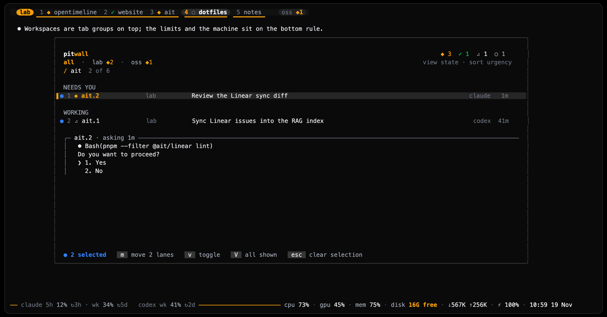
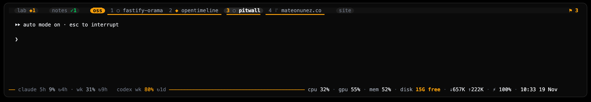

# pitwall

<p align="center">
  
</p>

<p align="center">
  <a href="https://github.com/mateonunez/pitwall/actions/workflows/main.yml"></a>
  <a href="LICENSE"></a>
  
</p>

Hey there! I'm **pitwall**. You run a few coding agents in tmux, and I keep an eye on all of them for you. Your status line tells you which one is working, which one is waiting for you, and which one finished while you were looking somewhere else. One key lists them all; another takes you straight to the one that needs you.

Your agents tell me what they are doing through a hook. I never poll, never read your prompts and never touch the network.

> **Status:** pre-1.0, used every day with Claude Code, Codex and Hermes. Things can still change between releases.

## Quick start

You need tmux 3.2 or newer. The installer uses python3 to edit your agents' settings safely.

**1. Add me to tmux.** Put this line next to your other plugins in your tmux config, then press `prefix` + `I` to let [TPM](https://github.com/tmux-plugins/tpm) fetch me:

```tmux
set -g @plugin 'mateonunez/pitwall'
```

**2. Put the `pitwall` command on your PATH:**

```sh
ln -s ~/.tmux/plugins/pitwall/bin/pitwall ~/.local/bin/pitwall   # or anywhere on your PATH
```

**3. Teach your agents to report:**

```sh
pitwall install           # shows what it would add, changes nothing
pitwall install --write   # adds it, with a backup next to each file it touches
```

**4. Restart your agents.** They read hooks when they start. Codex asks you to trust each new hook, and Hermes asks you to approve each one once: say yes.

**5. Check.** `pitwall doctor` lists anything still missing.

Just want a look first? `pitwall demo` starts a throwaway tmux server with a few fake lanes (attach with `tmux -L pitwall-demo attach`), and `pitwall demo stop` removes it.

<details>
<summary>Without TPM</summary>

```sh
git clone https://github.com/mateonunez/pitwall.git
ln -s "$PWD/pitwall" ~/.tmux/plugins/pitwall
ln -s "$PWD/pitwall/bin/pitwall" ~/.local/bin/pitwall
```

Then add `run-shell ~/.tmux/plugins/pitwall/pitwall.tmux` to your tmux config, reload it, and continue from step 3.
</details>

## The keys to remember

| Key | Does |
| --- | --- |
| `prefix A` | **The board**: every lane, with a live preview |
| `prefix a` | **Jump** to the next lane that needs you; again to cycle |
| `prefix W` | **Workspaces**: go to one, create or rename one |
| `prefix R` | **Restore** the agents a dead tmux took with it |
| `prefix ?` | tmux's own help, which lists these too |

Forgot one? `pitwall keys` prints every key, in tmux and in the board.

## Which agents

| Agent | What you see | What you do |
| --- | --- | --- |
| Claude Code | working, asking, done, gone; subagents included | `pitwall install --write`, restart Claude |
| Codex | working, asking, done, gone | `pitwall install --write`, restart Codex, trust the hooks |
| Hermes | working, asking, done, gone | `pitwall install --write`, restart Hermes, approve the hooks once |
| gemini, qwen, opencode, grok, pi, droid, amp, cursor-agent, copilot, crush, goose, aider, kiro-cli | the lane, at rest (`○`) | nothing; to see more, wire its hooks as below |

For Hermes, the installer adds a `hooks:` block at the end of `~/.hermes/config.yaml` and leaves the rest of the file, comments included, as it was. If your config already has a `hooks:` block, it prints the lines to paste instead.

<details>
<summary>Wiring another agent</summary>

Any agent with hooks can report. Have each hook run `bin/pitwall-hook <Event> <agent>` with a JSON payload on stdin that carries `session_id` and `cwd`:

| Event | Lane becomes |
| --- | --- |
| `SessionStart` | idle |
| `UserPromptSubmit` · `PreToolUse` · `PostToolUse` | working |
| `PermissionRequest` | asking |
| `Stop` | done (or idle, if you are looking at it) |
| `SessionEnd` | gone |

Restore already knows how to resume grok, opencode and pi. For any other agent, tell it how: `set -g @pitwall-resume-mytool 'mytool --resume {id}'`. To recognise more programs as lanes, change `@pitwall-agents`.
</details>

## What you get

- **A status line that says who needs you.**
  - `◆` amber: the agent is asking you something. It turns red after ten minutes.
  - `✓` green: it finished while you were elsewhere, and stays until you visit.
  - A spinner while it works, including subagents left running in the background.
  - `○` when it rests, and `✗` when it has gone.

  I slip these into the format your theme already has, so your theme stays yours.
- **The board** (`prefix A`), a small manager for your lanes. Filter as you type (`/`), search what the lanes printed (`//`), look at one workspace (`w`), or see one row per workspace when there are fifty of them (`g`). Select lanes (`v`, `V`) and move them to another workspace (`m`). Their agents keep running.
- **The jump** (`prefix a`) takes you to the next lane that is asking or done.
- **Several agents in one window.** Each pane is its own lane (`ait.1`, `ait.2`), and the window shows the most urgent one.
- **Names that mean something.** A window running Claude Code would show up as `2.1.323`; I name it after the agent's folder instead.
- **Your agents survive a dead tmux.** When the tmux server dies, you see `↺ 4` the next time you start it. `prefix R`, or `pitwall restore` from any terminal, rebuilds the sessions, windows and panes and resumes each agent where it was. An agent you closed on purpose stays closed.
- **Workspaces.** A workspace is a tmux session. `prefix W` lists them with who waits in each, and you move lanes between them from the board or with `pitwall move farm qa`. With tmux's `renumber-windows` on, moving a window out leaves no gap in the numbers.
- **Context on every lane.** The board's preview shows the model, how full the context is and the tokens used. Your Claude and Codex usage limits sit in the status line with the time left to each reset (`claude 5h 8% ↻4h · wk 34% ↻5d`), read from [CodexBar](https://github.com/steipete/CodexBar). They turn amber at 80%.
- **Lanes as worktrees.** `pitwall new fix-login` creates a worktree with [gwm](https://github.com/kbrdn1/gwm), opens a window there and starts your agent. `pitwall done @3` shows the diff in [lumen](https://github.com/jnsahaj/lumen) and removes the worktree if you confirm.
- **Beyond the terminal.** Connect an [OpenTimeline](https://github.com/mateonunez/opentimeline) seat with `pitwall ot connect <token-file>`: a lane that starts asking shows up in its Needs you and clears when the lane moves on. Only the state, the agent and its metrics are sent, never prompts or task titles.
- **Made for agents as well.** `pitwall ls` prints one line per lane with a short ref (`@1 lab/opentimeline asking 3m codex Cut the 0.2.0 release`), `--json` for scripts, and `pitwall peek @1` shows a lane's last lines.

## Tabs, if your status line is full

```tmux
set -g @pitwall-layout tabs
set -g @pitwall-system on   # optional: cpu, gpu, memory, disk, network, battery
```



- **On top: your workspaces, as Chrome-style tab groups.** Each workspace is a pill that counts who waits there (`lab ◆1`). The one you are in opens into its windows: numbered for `prefix 1`–`9`, joined by an amber underline, with the current one lifted. Tabs shrink to fit, and clicking a pill or a tab takes you there.
- **At the bottom: a thin line with the numbers.** Your usage limits are on the left. With `@pitwall-system on`, the right side shows the machine: cpu, gpu, memory, free disk, network, battery and the clock. A value turns amber only when it needs a look. In a narrow pane it keeps cpu, memory and disk.

The numbers are read every few seconds, only while you are attached, in about 80 ms and without root. The round tab ends need a [Nerd Font](https://www.nerdfonts.com); `set -g @pitwall-tab-caps off` gives plain ends. `set -g @pitwall-layout inline` brings your theme's status line back.

## In the board

| Key | Does |
| --- | --- |
| `n` `e` · `d` `D` · `1`–`9` | Down, up · first, last · jump to a row |
| `i` `⏎` | Go to the lane |
| `/` | Filter as you type (name, workspace, task, agent, state); `⏎` keeps it, `esc` drops it |
| `//` | Search the lanes' recent output (`//rate limit`), on `⏎` |
| `w` | One workspace, the next one, then all again |
| `g` | Group by state, by workspace, or one row per workspace |
| `s` | Sort by urgency, newest or name |
| `v` · `V` | Select the lane · select everything shown |
| `m` | Move the selection (or the lane under the cursor) to a workspace; `c` there creates one |
| `esc` | Drop the selection, then the filter, then close |
| `?` · `h` `q` | Every key · close |

Keys follow Colemak and vim (`n` `e` down and up). Selections are careful: they follow lanes as they re-sort, lanes hidden by the filter are counted ("1 hidden by the filter"), the footer always names what `m` will move, and `esc` peels one layer at a time. A test drives the real board for each of these.

## Commands

| Command | Does |
| --- | --- |
| `pitwall ls [--json]` | Every lane, the ones that need you first |
| `pitwall peek @N [lines]` | The last lines of a lane |
| `pitwall go @N` · `pitwall next` | Go to a lane · to the next one that needs you |
| `pitwall board` | The board, outside a popup |
| `pitwall stats [@N]` | Model, context and tokens per lane |
| `pitwall quota [--refresh]` | Claude and Codex usage limits |
| `pitwall saved` | The agents I can bring back |
| `pitwall restore [--dry\|--all]` | Bring them back, each resumed |
| `pitwall forget <id>` | Drop a saved agent |
| `pitwall ws` | Workspaces; also `new <name> [dir]`, `go`, `rename <old> <new>`, `close <name>` |
| `pitwall move <@N\|window> <workspace>` | Move a lane, agents still running, to a workspace (created if new) |
| `pitwall new <name> [--agent codex]` · `pitwall done @N` | Worktree, window and agent in one go · review and clean up |
| `pitwall ot connect <token> [--url URL]` · `pitwall ot bell <token>` | OpenTimeline signals · its Needs you count in the status line |
| `pitwall install [--write]` | Hooks for Claude Code, Codex and Hermes |
| `pitwall doctor` | What is missing |
| `pitwall demo [stop]` | A throwaway server with fake lanes |
| `pitwall keys` | Every key |

## Options

Set them in your tmux config before the plugin line.

| Option | Default | Does |
| --- | --- | --- |
| `@pitwall-key-board` · `-next` · `-workspaces` · `-restore` | `A` · `a` · `W` · `R` | The keys after `prefix` |
| `@pitwall-layout` | `inline` | `tabs` for the layout above |
| `@pitwall-system` | `off` | The machine's numbers on the bottom line (tabs layout) |
| `@pitwall-system-interval` | `5` | Seconds between readings |
| `@pitwall-quota` | `on` | Usage limits in the status line |
| `@pitwall-codexbar` | the CLI inside CodexBar.app | Path to `CodexBarCLI` |
| `@pitwall-urgent-after` | `600` | Seconds of asking before a lane turns red; `0` turns it off |
| `@pitwall-toast` | `on` | A short message when a lane starts asking or finishes |
| `@pitwall-rename` | `on` | Name agent windows after their folder |
| `@pitwall-agent` | `claude` | The agent `pitwall new` starts |
| `@pitwall-agents` | claude, codex, gemini, qwen, opencode, grok, pi and more | Programs that make a pane a lane, as a regex |
| `@pitwall-resume-<agent>` | known for claude, codex, hermes, grok, opencode, pi | How a saved session resumes, `{id}` for its id |
| `@pitwall-color-asking` · `-done` · `-gone` | `#f59e0b` · `#00c758` · `#fb2c36` | Glyph colours |
| `@pitwall-color-strip` · `-tab` · `-pill` | `#111111` · `#2a2a2a` · `#1f1f1f` | Tab strip, current tab, workspace pills |
| `@pitwall-tab-caps` | `on` | Round tab ends (needs a Nerd Font) |
| `@pitwall-tick-interval` | `0.12` | Seconds per spinner frame |

## Something's off?

- **Start with `pitwall doctor`.** It says what is missing and how to fix it.
- **A lane never changes state.** Did you restart the agent after `pitwall install --write`? Codex needs you to trust the new hooks and Hermes to approve them; until then they do not run.
- **An agent is not listed at all.** It may run under a name I do not know: add it to `@pitwall-agents`.
- **The tabs show little boxes.** Your terminal font has no Nerd Font glyphs: install one, or `set -g @pitwall-tab-caps off`.
- **No usage limits.** They come from [CodexBar](https://github.com/steipete/CodexBar), on macOS. Without it, the status line simply leaves them out.
- **Two Hermes sessions in one folder.** I cannot tell them apart yet, so I leave both alone rather than guess.

## How it fits together


The hook runs next to your agents' other hooks on every tool call, so it stays in plain `sh` and makes two tmux calls when nothing changed. Drawing is tmux format strings reading pane options: no process starts per redraw. Each agent session leaves a small record in `~/.local/state/pitwall/lanes/` so restore knows what to bring back.

Some agents run their hooks outside tmux: Codex from a shared daemon, Hermes from its gateway. Then I find the lane by its session, then by its folder (for Hermes, the one stored in its own session database), and for two Codex in one folder by the thread name in their titles. When that is still ambiguous, I change nothing rather than the wrong lane. The words I use are in [CONTEXT.md](CONTEXT.md).

## What's next

Lane actions from the board, metrics over time, and a skill so agents learn to read the fleet. The reasoning is in [docs/roadmap.md](docs/roadmap.md).

## Develop

`test/run.sh` runs every check on a throwaway tmux server and never touches yours. [AGENTS.md](AGENTS.md) has the rules for changing me.

Releases follow [Conventional Commits](https://www.conventionalcommits.org): release-please keeps a release PR open with the next version and its changelog, and merging it tags the release. `pitwall --version` prints what you run.

## License

MIT
