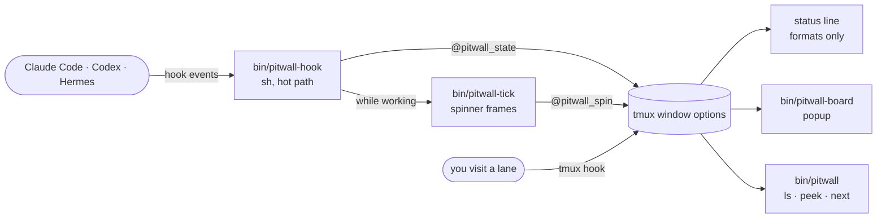

# pitwall

<p align="center">
  
</p>

<p align="center">
  <a href="https://github.com/mateonunez/pitwall/actions/workflows/main.yml"></a>
  <a href="LICENSE"></a>
  
</p>

Hey there! I'm **pitwall**. You run a handful of coding agents in tmux, one per window. I keep an eye on all of them and put what each one is doing right in your status line: working, waiting for you, or finished while you were looking somewhere else. One key shows every lane; another takes you to the one that needs you.

Your agents tell me their state through a hook. I never poll, never read a transcript and never touch the network.

> **Status:** pre-1.0, used every day on one machine with Claude Code, Codex and Hermes. Expect behaviour to change between commits.

## Quick start

You need tmux 3.2 or newer and a POSIX shell. The installer uses python3 to edit JSON safely.

```sh
git clone https://github.com/mateonunez/pitwall.git
ln -s "$PWD/pitwall" ~/.tmux/plugins/pitwall
ln -s "$PWD/pitwall/bin/pitwall" ~/.local/bin/pitwall   # or anywhere on your PATH
```

Add me to your tmux config next to your other plugins, then reload it:

```tmux
set -g @plugin 'mateonunez/pitwall'
```

Teach your agents to report:

```sh
pitwall install           # shows the hook lines it would add, changes nothing
pitwall install --write   # adds them, with a backup beside each file
pitwall doctor            # says what is missing, and exits 1 when something is
```

Restart your agents so they pick up the hooks; Codex asks you to trust each new one, Hermes to approve each once. For Hermes the installer appends a `hooks:` block to `~/.hermes/config.yaml` and keeps the rest of the file as it is; a config that already has one gets the lines to paste. Only want to look? `pitwall demo` starts a throwaway tmux server with a few fake lanes, and `pitwall demo stop` removes it.

## Other agents

Claude Code, Codex and Hermes report through hooks that `pitwall install` sets up. Any pane running gemini, qwen, opencode, grok, pi, droid, amp, cursor-agent, copilot, crush, goose, aider or kiro-cli shows up as a lane too, before any hook (`@pitwall-agents` holds the list as a regex of process names).

To give another agent real states, have its hooks run `bin/pitwall-hook <Event> <agent>` with a JSON payload on stdin that carries `session_id` and `cwd`:

| Event | State |
| --- | --- |
| `SessionStart` | idle |
| `UserPromptSubmit` · `PreToolUse` · `PostToolUse` | working |
| `PermissionRequest` | asking |
| `Stop` | done, or idle if you are looking at it |
| `SessionEnd` | gone |

Restore resumes grok, opencode and pi out of the box; any other agent once `@pitwall-resume-<agent>` says how (`'mytool --resume {id}'`).

## What you get

- **A status line that says who needs you.** `◆` amber: the agent is asking you something. `✓` green: it finished while you were elsewhere, and stays until you visit. A spinner while it works, subagents it left running in the background included, `○` when it rests, `✗` when it has gone. I slip the glyph in front of the window name inside the format your theme already has, so your theme stays yours.
- **Instant, and quiet when nothing moves.** A change redraws every status line at once and shows a short toast to anyone not already looking at that lane. The spinner turns only while something works, then the ticker exits.
- **The board, a manager for your lanes.** `prefix A` lists every lane with a live preview of the one under the cursor, and lets you find and handle them from the keyboard: filter as you type (`/`), search what the lanes printed (`//`), look at one workspace (`w`), group by state or workspace, or see one row per workspace when there are fifty of them (`g`), select (`v`, `V`) and move what you selected (`m`). Keys are Colemak and vim, listed below and behind `?`.
- **Tabs, if your status line is full.** `set -g @pitwall-layout tabs` moves the status line to the top as Chrome-style tab groups. Each workspace is a pill with a count of who waits there (`lab ◆1`); the one you are in opens into its windows, numbered for `prefix 1`–`9`, joined by one amber underline like a Chrome tab group, the current one lifted off the strip. Tabs shrink to fit, and a click on a pill or a tab takes you there. The bottom of your panes becomes a thin rule: usage limits on the left and, with `@pitwall-system on`, the machine on the right (cpu, gpu, memory, free disk, network, battery, clock), amber only when one needs a look, giving way to cpu, memory and disk when a pane is narrow. A sampler reads them every few seconds while a client is attached, in about 80 ms and without root. `inline` gives your theme its status line back.

  
- **The jump.** `prefix a` takes you to the next lane that is asking or done. Press it again to cycle.
- **Several agents in one window.** Each pane is its own lane (`ait.1`, `ait.2`); the window shows the most urgent of them.
- **Names that mean something.** A window running Claude Code shows up as `2.1.323`; I name it after the agent's directory instead.
- **Your agents survive a dead tmux.** Every agent session leaves a small record as it works. When the tmux server dies, the status line says `↺ 4` next time, and `prefix R` (or `pitwall restore` from any terminal) rebuilds the sessions, windows and panes and resumes each agent where it was. An agent you closed on purpose stays closed.
- **Context on every lane.** The board's preview names the model, how full the context is and how many tokens the session has used, read from the agent's own transcript; `pitwall stats` prints it for all lanes. Your Claude and Codex usage limits sit in the status line with the time left to each reset (`claude 5h 8% ↻4h · wk 34% ↻5d`), from [CodexBar](https://github.com/steipete/CodexBar), refreshed when a turn ends. A number turns amber at 80%, and so does a week on course to run out before its reset.
- **Workspaces.** A workspace is a tmux session. `prefix W` lists them with their lanes' states, takes you to one, creates or renames one. In the board, `m` moves a lane's window to another workspace, or a new one, and its agents keep running; `pitwall move farm qa` does it from the shell. The status line names other workspaces that need you (`◆ qa`), and restore puts lanes back where they now live. With tmux's `renumber-windows` on, a window that moves out of a workspace leaves no gap either, however you moved it; tmux on its own renumbers only when a window closes.
- **Lanes as worktrees.** `pitwall new fix-login` makes a worktree with [gwm](https://github.com/kbrdn1/gwm), opens a window there and starts your agent. `pitwall done @3` shows the diff in [lumen](https://github.com/jnsahaj/lumen), and removes the worktree only if you say so.
- **Nothing waits unnoticed.** A lane that has been asking for ten minutes turns its `◆` red and shows a toast; there is no polling, just one delayed check scheduled when it starts asking.
- **Needs you, beyond the terminal.** Connect an [OpenTimeline](https://github.com/mateonunez/opentimeline) system seat with `pitwall ot connect <token-file>` and a lane that starts asking shows up in its Needs you, turns urgent after ten minutes, and clears when the lane moves on. Signals carry the state, the agent and its metrics, never prompts or task titles. With `pitwall ot bell <token-file>`, Needs you's count sits in the status line (`⚑ 3`).
- **Made for agents as well.** `pitwall ls` prints one line per lane with a ref (`@1 lab/opentimeline asking 3m codex Cut the 0.2.0 release`), `--json` for scripts, and `pitwall peek @1` shows that lane's last lines. An orchestrator reads your whole fleet with one call.

## Keys and commands

| Key | Does |
| --- | --- |
| `prefix A` | The board |
| `prefix a` | Next lane that needs you |
| `prefix R` | Restore the lanes a dead tmux took with it |
| `prefix W` | Workspaces: go to one, create or rename one |

Each of them carries a note, so tmux's own help (`prefix ?`) lists them too, and `pitwall keys` prints this whole page of keys in the terminal. In the board:

| Key | Does |
| --- | --- |
| `n` `e` · `d` `D` · `1`–`9` | Down, up · first, last · a row shown |
| `i` `⏎` | Jump into the lane |
| `/` | Filter as you type: name, workspace, task, agent, state. `ctrl-n` `ctrl-e` move while typing, `⏎` keeps the filter, `esc` drops it |
| `//` | Search the lanes' recent output (`//rate limit`), on `⏎` |
| `w` | One workspace, the next one, then all again |
| `g` | View by state, by workspace, or one row per workspace (`⏎` opens one, `v` selects its lanes) |
| `s` | Sort by urgency, newest or name |
| `v` · `V` | Select the lane · select everything shown (or unselect it) |
| `m` | Move the selection, or the lane under the cursor, to a workspace; `c` there makes a new one |
| `esc` | Drop the selection, then the filter, then close |
| `?` · `h` `q` | Every key · close |

### Selecting, safely

Selections are where list tools usually let you down, so mine follow a few rules, each covered by a test that drives the real board:

- **A selection follows lanes, not rows.** Lanes re-sort as their states change; a selected lane stays selected wherever it moves.
- **Nothing hidden is acted on silently.** When the filter hides selected lanes, the footer counts them ("1 hidden by the filter"), and so does the move prompt.
- **The target is always spelled out.** With a selection, the footer reads "m move 3 lanes"; without one, `m` acts on the lane under the cursor.
- **One layer at a time.** `esc` drops the selection first, then the filter and the workspace, and only then closes the board.
- **Nothing stays armed.** A selected lane that closes leaves the selection, with a note; a move clears the selection.

| Command | Does |
| --- | --- |
| `pitwall ls [--json]` | Every lane, the ones that need you first |
| `pitwall peek @N [lines]` | The last lines of a lane |
| `pitwall go @N` | Jump to a lane |
| `pitwall next` | Jump to the next lane that is asking or done |
| `pitwall board` | The board, outside a popup |
| `pitwall stats [@N]` | Model, context and tokens per lane |
| `pitwall quota [--refresh]` | Claude and Codex usage limits |
| `pitwall saved` | The lanes pitwall can bring back, and which are running or closed |
| `pitwall restore [--dry\|--all]` | Reopen them, resuming each agent |
| `pitwall forget <id>` | Drop a saved lane |
| `pitwall ws` | Workspaces with their lanes; also `new <name> [dir]`, `go`, `rename <old> <new>`, `close <name>` |
| `pitwall move <@N\|window> <workspace>` | Move a lane's window, agents still running, to a workspace (created if new) |
| `pitwall ot connect <token> [--url URL]` | Send lane states to OpenTimeline; also `status`, `flush`, `disconnect` |
| `pitwall ot bell <token>` | Needs you's count in the status line; `off` to stop |
| `pitwall new <name> [--agent codex]` | Worktree, window and agent in one go |
| `pitwall done @N` | Review the diff, then remove the worktree if you confirm |
| `pitwall install [--write]` | The hook lines for Claude Code, Codex and Hermes |
| `pitwall doctor` | What is missing |
| `pitwall demo [stop]` | A throwaway server with fake lanes |
| `pitwall keys` | Every key, in tmux and in the board |

## Options

Set them before the plugin loads, like any tmux option.

| Option | Default | Does |
| --- | --- | --- |
| `@pitwall-key-board` | `A` | Key for the board |
| `@pitwall-key-next` | `a` | Key for the jump |
| `@pitwall-key-restore` | `R` | Key for restore |
| `@pitwall-key-workspaces` | `W` | Key for workspaces |
| `@pitwall-agent` | `claude` | Agent `pitwall new` starts |
| `@pitwall-agents` | claude, codex, gemini, qwen, opencode, grok, pi and more | Processes that make a pane a lane before any hook, as a regex |
| `@pitwall-resume-claude` · `-codex` · `-hermes` | `claude --resume {id}` · `codex resume {id}` · `hermes --resume {id}` | How a saved session resumes |
| `@pitwall-quota` | `on` | Usage limits in the status line |
| `@pitwall-codexbar` | the CLI inside CodexBar.app | Path to `CodexBarCLI` |
| `@pitwall-color-asking` · `-done` · `-gone` | `#f59e0b` · `#00c758` · `#fb2c36` | Glyph colours |
| `@pitwall-rename` | `on` | Name agent windows after their directory |
| `@pitwall-toast` | `on` | Toast when a lane starts asking or finishes |
| `@pitwall-urgent-after` | `600` | Seconds of asking before a lane turns urgent; `0` turns it off |
| `@pitwall-tick-interval` | `0.12` | Seconds per spinner frame |
| `@pitwall-layout` | `inline` | `tabs`: workspace tab groups on top, limits and the machine on the panes' bottom rule |
| `@pitwall-system` | `off` | The machine on the bottom rule (tabs layout) |
| `@pitwall-system-interval` | `5` | Seconds between machine samples |
| `@pitwall-color-strip` · `-tab` · `-pill` | `#111111` · `#2a2a2a` · `#1f1f1f` | Tab strip, current tab, workspace pills |
| `@pitwall-tab-caps` | `on` | Round tab ends; they need a Nerd Font, `off` for plain ends |

## How it fits together



The hook runs on every tool call next to whatever else you have hooked, so it stays in `sh` and makes two tmux calls when nothing changed. It writes the restore record (`~/.local/state/pitwall/lanes/<session>`) only when a session starts and once per turn. Rendering is tmux format strings reading window options: no process per redraw. Without hooks I still read a working Codex from the spinner in its pane title. When an agent runs its hooks outside tmux, as Codex does from its shared daemon, I find the lane by its session, then by its directory, and for two Codex in one directory by the thread name in their titles; when that stays ambiguous I change nothing rather than the wrong lane. The domain words are in [CONTEXT.md](CONTEXT.md).

## What's next

Lane actions from the board, metrics over time, and a skill so agents learn to read the fleet. The reasoning is in [docs/roadmap.md](docs/roadmap.md).

## Develop

`test/run.sh` runs every check on a throwaway tmux server and never touches yours: its config, state and OpenTimeline connection are temporary. [AGENTS.md](AGENTS.md) has the rules for changing me.

Releases follow [Conventional Commits](https://www.conventionalcommits.org): release-please keeps a release PR open on `main` with the next version and the changelog, and merging it tags the release. `pitwall --version` prints what you run.

## License

MIT
